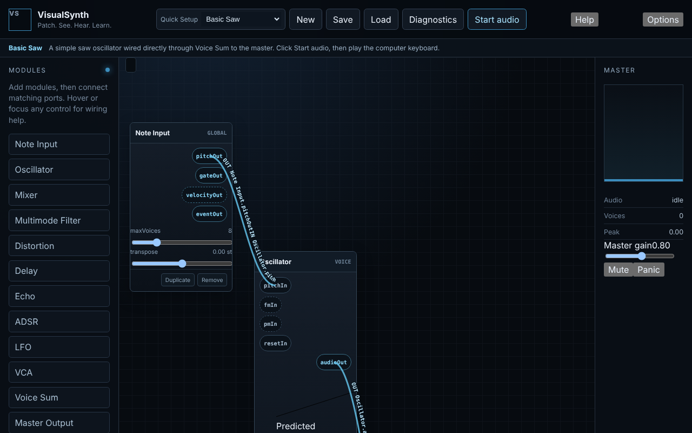
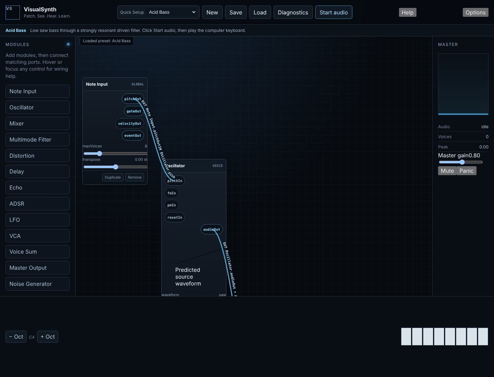

# VisualSynth

VisualSynth is a browser-based visual modular synthesizer from Circuit Drift Labs. It is an early working implementation (v0.1.0): a static ES-module web app with an AudioWorklet DSP engine, a patch-cable workspace, factory presets and diagnostics, backed by a full specification set.

The governing design rule is: **everything that affects the sound should, wherever practical, be visible.** The paired quality test is that an experienced synthesizer user must still find the instrument useful after educational assistance is disabled.





## What works today

- Visual patch workspace: draggable modules, typed ports, click-to-connect cables with signal labels, duplicate/remove.
- Modules: Note Input, Oscillator, Noise Generator, Mixer, Multimode Filter, ADSR, LFO, VCA, Voice Sum, Distortion, Delay, Echo, Master Output.
- AudioWorklet engine with polyphonic voice allocation, parameter smoothing, event queue and output safety guard.
- Input: computer keyboard (A W S E D F T G Y H U J K, Z/X octave shift) and Web MIDI where supported.
- 24 factory "Quick Setup" presets, New/Save/Load (browser storage), versioned patch schema with migrations, undo history.
- Visualization: waveform and spectrum views driven by a central scheduler, master meter, Diagnostics panel (copyable JSON, no private data).
- Help/guidance overlay and accessibility/responsive tests.

Not yet implemented (see `docs/DEVELOPMENT_PLAN.md`): Learning Mode lessons, Compare Mode, probes/signal inspector, recording/export, sequencing, randomization/automation.

## Quick start

Requires Node 22.

```sh
npm install
npm run serve                 # http://127.0.0.1:4173/ (Vite)
npm test                      # Vitest unit + integration (148 tests)
npx playwright install chromium firefox
npm run test:browser          # Playwright browser tests (served at /visualsynth/)
```

Browsers require a click on **Start audio** before sound can play. The site is deployed to GitHub Pages from `main` (`.github/workflows/pages.yml`): https://djshellshoxxx.github.io/visualsynth/

## Project layout

- `index.html`, `styles/`, `ui-assistance.js` — static shell and styling
- `src/dsp/` — environment-neutral DSP (oscillator, filters, envelope, LFO, effects, safety)
- `src/engine/` — AudioWorklet processor, voice allocator/engine, event queue, parameter runtime
- `src/graph/` — module registry, type model, validation and graph compiler
- `src/modules/` — module definitions and per-module UI
- `src/state/`, `src/persistence/`, `src/presets/` — patch state/history, schema/migrations/storage, factory presets
- `src/ui/`, `src/visual/`, `src/input/`, `src/help/` — workspace, visualization, keyboard/MIDI, guidance
- `tests/unit`, `tests/integration`, `tests/browser` — Vitest and Playwright suites
- `spec/`, `research/`, `docs/` — specification, research and plans; `shared/scripts/`, `skills/` — contributor tooling (see `AGENTS.md`)

## Specification set

- `research/RESEARCH.md`, `research/REFERENCES.md` — findings and sources
- `spec/PROJECT_SPEC.md`, `ARCHITECTURE.md`, `DSP_SPEC.md`, `MODULE_SPEC.md`, `GUI_SPEC.md`, `VISUALIZATION_SPEC.md`, `PATCH_FORMAT.md`, `REQUIREMENTS_MATRIX.md`, `ACCEPTANCE_CRITERIA.md`, `SPEC_AUDIT.md`
- `docs/DEVELOPMENT_PLAN.md` — phased build plan; `docs/arm-stability-effects-notes.md` — cable stability/presets/effects notes

The specs call for TypeScript; the current implementation is plain JavaScript ES modules.

## Reference project

BrowserToneGen is used as reference material only and is not modified by this project.

## Status

Early implementation (v0.1.0). Specification is the source of truth; implementation is ahead of the written plan status.

## License

MIT, see `LICENSE`. Brand and trademark terms: `COPYRIGHT-TRADEMARK.md`.

## Circuit Drift Labs

VisualSynth is part of Circuit Drift Labs:

https://djshellshoxxx.github.io/circuitdriftlabs/
